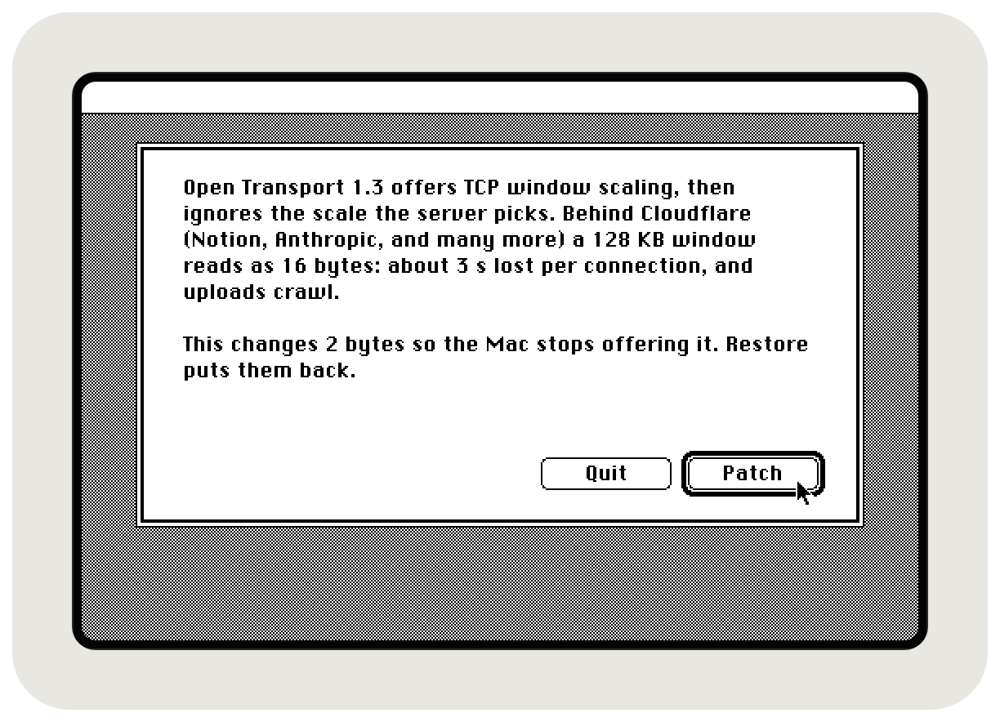
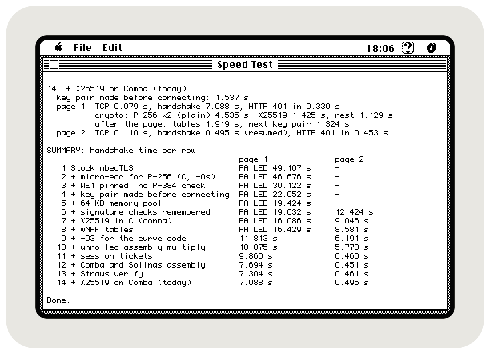
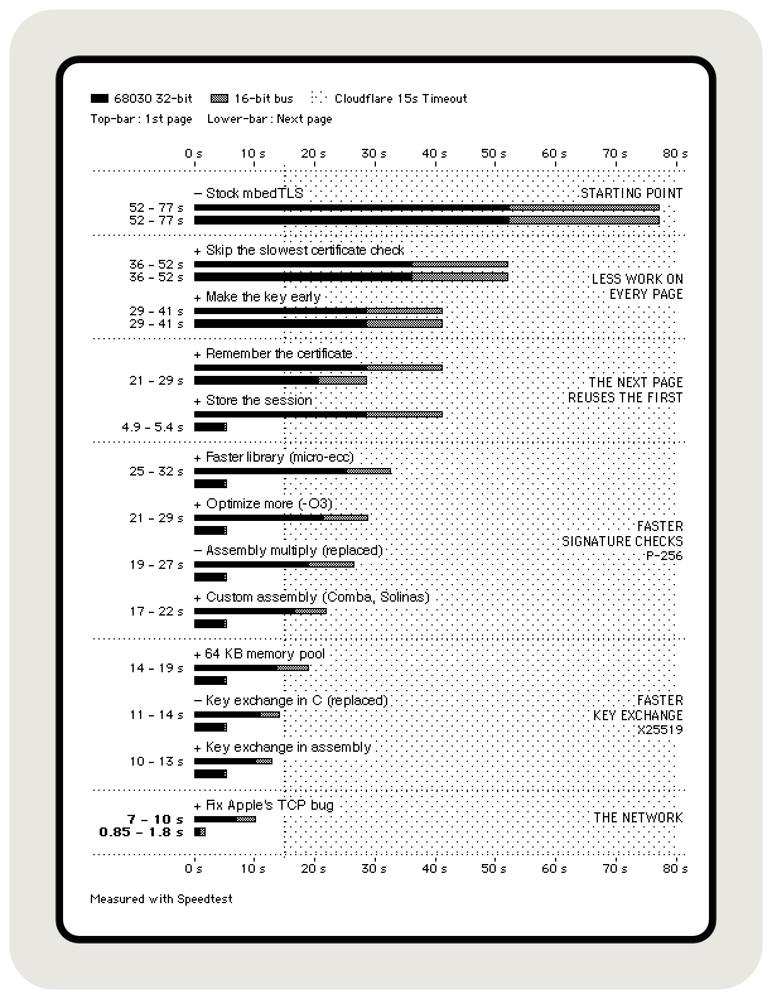
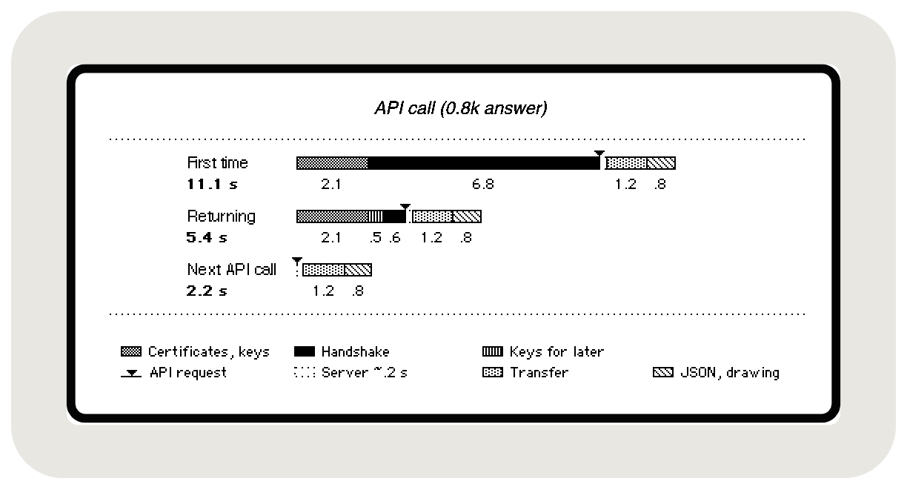

### 3 seconds faster!



> [!TIP]
> **Fix for the Open Transport 1.3 bug** that makes your Classic Mac lose 3 seconds on every connection to some servers, such as Notion and Anthropic behind Cloudflare. [Open Transport Bug Patcher](OpenTransportBugPatcher/) changes 2 bytes to fix it, and the change can be undone with the same patcher.

### Download

<a href="https://github.com/SLKK-design/HTTPS-68K-Speedtest/releases/latest/download/OpenTransportBugPatcher.sit"></a>Get [OpenTransportBugPatcher.sit](https://github.com/SLKK-design/HTTPS-68K-Speedtest/releases/latest/download/OpenTransportBugPatcher.sit) (StuffIt, for the Mac itself) or [OpenTransportBugPatcher.zip](https://github.com/SLKK-design/HTTPS-68K-Speedtest/releases/latest/download/OpenTransportBugPatcher.zip).

# HTTPS 68K Speedtest

**How long does a modern HTTPS handshake take on a 68k Mac? Speed Test times it on yours.**

Notion Classic and Claude 68 talk TLS 1.2 straight to `api.notion.com` and `api.anthropic.com` from a 16 MHz 68030, with no proxy. With stock mbedTLS, a handshake took 49 seconds on a Mac SE/30, and Cloudflare hangs up after about 15. Now it takes 7 seconds, and under one to resume.

Speed Test replays how it got there. It runs nearly every handshake method the apps have ever used, oldest first, on the Mac it runs on, so every step of the story is measured instead of estimated.

*Speed Test on the SE/30: stock mbedTLS fails after 49.1 s, today's engine needs 7.09 s, and 0.50 s to resume.*



## What it found

The chart adds the changes one at a time: less work first, then faster math, then the Open Transport fix. On the SE/30 a first page, a handshake plus one small request, went from 52 s to 7 s, and the next page from 52 s to under a second. The Classic II, on its 16-bit bus, went from 77 s to 10 s and 1.8 s.

*Black is the SE/30, grey the Classic II.*



A handshake is only the start. One API call takes this long, until its answer is on screen:

*The transfer and drawing of a short answer, from a server that answers in about 0.2 s.*



More complex calls take longer: [a Notion page](https://github.com/SLKK-design/NotionClassic#how-fast-and-how-i-know) takes 17.5, 7.5 and 3.3 s, because it makes three API calls and the Mac reads and draws 29 KB of JSON. [A Claude answer](https://github.com/SLKK-design/Claude68#how-fast), on the other hand, takes 19.4, 10.5 and 6.3 s because Claude thinks and writes while the Mac waits.

**More technical info:**
- [HTTPS on a 37-Year-Old Mac](docs/modern-HTTPS-on-68k.md), the deep dive: how each step works
- [The measured runs](results/)
- [How Speed Test found the Open Transport bug](OpenTransportBugPatcher/README.md)


## Building Speed Test

The release has the app ready to run. To build it yourself, you need [Retro68](https://github.com/autc04/Retro68) and a checkout of [Claude 68](https://github.com/SLKK-design/Claude68), whose engine Speed Test compiles. CMake looks for it in `../Claude68`; anywhere else, pass its path as below.

```bash
cmake -S . -B build -DCMAKE_TOOLCHAIN_FILE=<Retro68-build>/toolchain/m68k-apple-macos/cmake/retro68.toolchain.cmake \
      -DCLAUDE68_DIR=<path to Claude68>
make -C build
```

The app ends up in `build/` as `SpeedTest.APPL`. Open Transport Bug Patcher builds on its own; [its README](OpenTransportBugPatcher/README.md) has the steps.

For the test-server runs, run `tools/lab/make_certs.sh` once (it makes a test certificate chain with its own keys), set `kLabIP` in `src/tests.cpp` to the server's address, build, and start `python3 tools/lab_server.py`.

How Speed Test switches between methods, and where its runs differ from what the apps did back then, is in [the results README](results/README.md#how-the-runs-were-made).


## Measure your Mac

I've only measured two 16 MHz 68030s, both on a SCSI network adapter (BlueSCSI and PiSCSI). I'd love numbers from a 68040, a Mac with a real Ethernet card, or one on plain MacTCP.

1. <a href="https://github.com/SLKK-design/HTTPS-68K-Speedtest/releases/latest/download/SpeedTest.sit"></a> Download [SpeedTest.sit](https://github.com/SLKK-design/HTTPS-68K-Speedtest/releases/latest/download/SpeedTest.sit) or [SpeedTest.zip](https://github.com/SLKK-design/HTTPS-68K-Speedtest/releases/latest/download/SpeedTest.zip).
2. On Open Transport 1.3, run [Open Transport Bug Patcher](OpenTransportBugPatcher/) first.
3. Choose **File > Run Everything** (Cmd-R) and leave it alone. The oldest methods need about a minute each; Cmd-period stops after the current step.
4. The results go into a SimpleText file next to the app. [Open an issue](https://github.com/SLKK-design/HTTPS-68K-Speedtest/issues) with it, and say which network adapter the Mac uses.

No account or token needed: each "page" is one request that Notion answers with HTTP 401, so nothing private is sent.

### What Run Everything does

- **Crypto Only:** each handshake operation, with nearly every method that was ever in the code, without the network. Every result is checked against known answers, so a fast but wrong method shows WRONG.
- **Today's Engine:** real connections to Notion, three of each: a first connection, one without a ticket, and a resumed one.
- **Compare Servers:** the same pages to Notion, Anthropic and Google. This is where the Open Transport bug showed up: only the Cloudflare servers stalled.
- **Each Chart Row:** stock mbedTLS, then the 13 changes in the order they were made, each added to the row above.

Three more runs, in the File menu, use a test server on your own network instead of Notion. It never hangs up, so the old methods can finish: that's how the stock 49 seconds were measured. They need your own build; see *Building Speed Test*.


## Sibling projects

<a href="https://github.com/SLKK-design/NotionClassic"></a>&nbsp; **[Notion Classic](https://github.com/SLKK-design/NotionClassic)**: reads and edits Notion pages.<br>
<a href="https://github.com/SLKK-design/Claude68"></a>&nbsp; **[Claude 68](https://github.com/SLKK-design/Claude68)**: a Claude chat client, and the starting point for your own 68k HTTPS app.<br>
<a href="https://github.com/SLKK-design/MacPlayer"></a>&nbsp; **[MacPlayer](https://github.com/SLKK-design/MacPlayer)**: Anthony Super's Spotify remote, working again.

## License

My code is released under [0BSD](LICENSE). `src/variants/unused_curve25519_donna.c` is [curve25519-donna](https://github.com/agl/curve25519-donna) by Adam Langley (BSD 3-clause, notice in the file). The app icons are Notion's "stopwatch" (Speed Test) and "swap-horizontally" (Open Transport Bug Patcher), redrawn as 1-bit pixels. They belong to Notion Labs, and 0BSD doesn't cover them.
