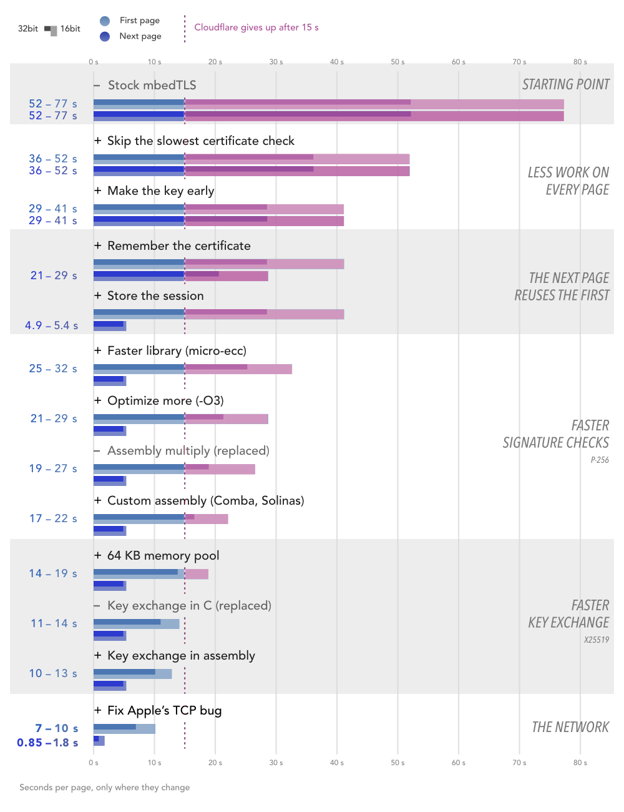

# HTTPS on a 37-Year-Old Mac
### Completing a modern TLS 1.2 handshake on a 16 MHz 68030

**Lin van der Slikke**, with **Claude Code** (Anthropic)
*The shared `src/core` engine behind two 68k clients. June 2026, updated October 2026.*

> This is the technical half of two projects: **[Notion Classic](https://classic.slkk.nl)**, a
> Notion client you can try in your browser, and **[Claude 68](https://github.com/SLKK-design/Claude68)**,
> a Claude client that doubles as HTTPS boilerplate. Both ship the same `src/core/net` engine.
> For the why, the machines and the browser demo, read
> [the story](https://github.com/SLKK-design/NotionClassic/blob/main/docs/the-story.md). This
> document lives with [Speed Test](../README.md), the app that measured its numbers, and the runs
> are in [`results/`](../results/).

---

## TL;DR

A 16 MHz 68030, the chip in a 1989 Macintosh SE/30, was never meant to do a modern elliptic-curve TLS handshake. With stock mbedTLS the math takes **49 s** on the SE/30 and **73 s** on a Classic II, and Cloudflare hangs up after about 15. Yet the Mac now makes a real TLS 1.2 connection straight to `api.notion.com` or `api.anthropic.com`, certificate checked, with no proxy and no modern computer doing the math.

Nine changes did it. Three make the math faster: micro-ecc, an interleaved double-scalar multiply and custom 68020 assembly. Four do less work: session tickets, state saved to disk, the key pair made ahead of time and a pinned intermediate certificate. One is a set of correctness fixes. And one is a 2-byte patch to Open Transport 1.3, which misread Cloudflare's TCP window. Today a first connection takes **about 7 s** on the SE/30 and **9 s** on the Classic II, and a resumed one **under a second**.

---

## 1. What a handshake costs

A [TLS 1.2](https://www.rfc-editor.org/rfc/rfc5246) handshake with a Cloudflare host is four jobs:

- an **[X25519](https://www.rfc-editor.org/rfc/rfc7748)** key exchange (ECDHE),
- an **ECDSA P-256** signature check on the server's `ServerKeyExchange`,
- a **certificate chain** to validate (leaf → intermediate → root),
- and then **[ChaCha20-Poly1305](https://www.rfc-editor.org/rfc/rfc8439)** to move the data.

The first three run on multi-precision arithmetic over 256-bit numbers (384-bit for the root's signature). On a desktop that's microseconds. On a 16 MHz 68030 without crypto hardware, one 256-bit scalar multiplication takes seconds, and the server is holding a stopwatch.

Three terms come back throughout. A **first connection** has nothing cached and does both P-256 checks. A **full handshake** is any handshake without a session ticket; after the first connection, its certificate check is cached. A **resumed handshake** uses a ticket and skips the public-key math.

**Why TLS 1.2.** TLS 1.3 is compiled out of the mbedTLS build, and `SslConfigSetup` in [`HttpClient.cpp`](https://github.com/SLKK-design/Claude68/blob/main/src/core/net/HttpClient.cpp) pins 1.2 as well. ChaCha20-Poly1305 is the only AEAD cipher the Mac offers: Cloudflare picked AES-GCM even when ChaCha20 came first in the list, and AES-GCM in software is slow on a 68k.

**What's mine.** I didn't start as an expert. My first version, written by hand in 2022, only did HTTPS in an emulator, where the host CPU does the math, and on the real Classic II it needed a Raspberry Pi as a proxy. Before 2026 I couldn't have told you what a TLS handshake does. I learned most of what's below while getting it onto the hardware, with Claude Code writing the code and explaining it, paper by paper.

One commenter called the result *"a vibecoded TLS stack on an OS with no memory protection or file permissions."* Fair. No cipher or protocol is invented here, and [mbedTLS](https://github.com/Mbed-TLS/mbedtls) runs the protocol, the certificate parsing and the cipher. These parts are custom:

- **68020 assembly** for the field multiply, square and P-256 reduction (Section 3.3), checked against known answers on the Mac and against host models that must match the portable C bit for bit.
- **An X25519 rewrite** on 8 × 32-bit limbs that uses that assembly. It passes RFC 7748's test vectors, including the 1,000-iteration test. It's **not constant-time** (the ladder swaps pointers, not masked values), and timing attacks are out of scope.
- **A faster ECDSA verify** added to [micro-ecc](https://github.com/kmackay/micro-ecc) (Section 3.2), tested on the host against micro-ecc's own `uECC_verify`, tampered signatures and hashes included.
- **A cache of verify results** and a **trust pin** on the WE1 intermediate (Sections 3.5 and 3.7).
- **An entropy source** (`mac_entropy.c`): interrupt timing and a seed file, because mbedTLS's own source in this build was a clock anyone could guess (Section 7).

None of the glue is independently audited, and the Mac has no memory protection. So treat it as a toy and point it at nothing you care about. "Vibecoded" says nobody looked; this document is me looking, in public. Section 7 lists what it doesn't do.

---

## 2. The machines and the baseline

### 2.1 Two Macs

| Machine | CPU | Bus | Role |
|---|---|---|---|
| Mac SE/30 (1989) | 68030 @ 16 MHz | 32-bit | primary target |
| Mac Classic II (1991) | 68030 @ 16 MHz | **16-bit** | slowest supported, the real test |

Same clock, but the Classic II's 16-bit bus halves its memory bandwidth, so every multiply that touches memory costs more. If it works there, it works.

Both run System 7.5.5 with Open Transport 1.3. Neither has an Ethernet card: the SE/30 gets online through a BlueSCSI v2 with Wi-Fi, the Classic II through a PiSCSI, each posing as a DaynaPORT SCSI/Link adapter. The adapters only move packets. TCP/IP and all of the TLS run on the Mac. The apps use the MacTCP API; on a Mac with Open Transport, Open Transport answers those calls.

The apps need a 68020 or later, because the assembly uses its 32-bit multiply, and run on System 7.5 to 8.1 in an 8 MB machine. That rules out the 68000 compacts: the Plus, the SE and the Classic.

### 2.2 Stock mbedTLS never finishes

Cloudflare hangs up long before a stock handshake ends. So in October 2026 [Speed Test](../README.md) ran every historical method against a test server on my network that never hangs up: the same cipher, a certificate chain of the same shape, and session tickets. A stock handshake took **49.0 s** on the SE/30 and **73.0 s** on the Classic II, close to the "about 70 seconds" in the README of antscode's mbedTLS port. On the Classic II the time goes here:

| Stock operation (Classic II) | Time |
|---|---|
| P-384 check of the intermediate (GTS Root R4's signature on WE1) | 25.3 s |
| Two P-256 checks (certificate and `ServerKeyExchange`) | 24.3 s |
| Making the X25519 key pair | 11.0 s |
| The X25519 shared secret | 10.6 s |
| Everything else | 1.8 s |

*October 19, 2026. One P-256 check is two scalar multiplications. Inside a handshake each operation runs a little slower than on its own; Section 5.1 times them on their own.*

Against the real server it never completes. In March 2026 an early SE/30 build got `mbedtls_ssl_handshake` error `-29312` (the connection closed) after **120.4 s (7,227 ticks)**. The Mac only notices once its own math is done, so that's how long the build kept computing, not how long the server waited.

The server's limit is about 15 s for the whole handshake. It isn't published, but more than a dozen SE/30 captures from March end at 902–920 ticks (15.0–15.3 s), and in October a 14.8 s handshake on the Classic II got through while a 15.0 s one didn't.

### 2.3 Two apps, one engine

| | **Notion Classic** | **Claude 68** |
|---|---|---|
| Talks to | `api.notion.com` | `api.anthropic.com` |
| Workload | REST page read/edit | SSE token streaming (chat) |
| Role | full-featured client | deliberate **boilerplate** |
| App partition | 4 MB | 2 MB |

*Table 1. The two clients on the shared engine.*

The engine carries no hostnames; SNI comes from the request URI. Behind a different CA chain, only the pinned certificates in `RootCert.cpp` change. RSA-signed certificates still work through mbedTLS's own RSA path, which is cheap on a 68k, and a server without session tickets just gets full handshakes.

Each repo keeps its own copy of `src/core`, and Notion Classic's [`scripts/diff_core.sh`](https://github.com/SLKK-design/NotionClassic/blob/main/scripts/diff_core.sh) shows where they drift. The crypto and handshake code is identical. What differs: the auth headers, Claude 68's streaming, how long a response may stay silent (60 s for Claude's slow first token, 30 s for Notion), and where the persistence code lives ([`tls_cache.h`](https://github.com/SLKK-design/Claude68/blob/main/src/core/helpers/tls_cache.h) in Claude 68, [`crypto_persist.h`](https://github.com/SLKK-design/NotionClassic/blob/main/src/core/net/crypto_persist.h) in Notion Classic).

---

## 3. Nine changes

Grouped by kind, not size: faster math (Sections 3.1–3.3), less work (3.4–3.7), correctness (3.8) and a network bug (3.9). On a first connection the biggest single saving is the trust pin, which drops a 15–25 s P-384 check. On every connection after that, it's session tickets.

### 3.1 Generic bignum is too slow

mbedTLS's portable bignum code allocates, loops and carries in the most general way possible. One stock P-256 check (two scalar multiplications) takes 7.3 s on the SE/30 and 11.5 s on the Classic II, and a first connection needs two.

So the curve math moved to [micro-ecc](https://github.com/kmackay/micro-ecc): fixed-size stack arrays, Jacobian coordinates and a Montgomery ladder in co-Z coordinates ([Rivain 2011](https://eprint.iacr.org/2011/338.pdf)). It plugs into mbedTLS's `*_ALT` mechanism without touching the library's source:

```c
/* src/core/lib/mbedtls/include/mbedtls/mbedtls_config.h */
#define MBEDTLS_ECDH_GEN_PUBLIC_ALT      /* our ephemeral keygen      */
#define MBEDTLS_ECDH_COMPUTE_SHARED_ALT  /* our ECDHE shared secret   */
#define MBEDTLS_ECDSA_VERIFY_ALT         /* our signature verify      */
```

Each `#define` compiles mbedTLS's own version out, so mbedTLS calls the one in [`uecc_alt.c`](https://github.com/SLKK-design/Claude68/blob/main/src/core/net/uecc_alt.c) instead.

On its own, at the project's default `-Os`, micro-ecc was only a little faster: a P-256 check in 6.6 s on the SE/30 and 8.3 s on the Classic II. What it offered was small, fixed-size code I could tune. With the trust pin (Section 3.7), the early key pair (3.6) and curve25519-donna, the first micro-ecc handshakes on the Classic II came down to about **16 s** with the certificate check cached. Sane at last, and still too slow.

### 3.2 A signature check is two scalar multiplications

A signature check computes u₁G + u₂Q: two scalar multiplications. On the Classic II the key-exchange check ("SKE") alone took **8.6 s**.

Shamir's trick (Straus, 1964) does both at once. With a width-3 wNAF recoding and a small table of |a|G ± |b|Q, each digit costs one point addition. Hankerson, Menezes & Vanstone (§3.3) cover both.

My first wNAF build was slower: 14 s, because it did three doublings per digit instead of one, 774 instead of 258. Fixed, it was no faster than a plain 3-bit window (6.4 s against 5.9 s). What it won was the table: 1.1 s to build, against 5.7 s for the window's 64 entries. The later steps stand on that table.

The current version (`uecc_verify_precomp4` in [`uECC.c`](https://github.com/SLKK-design/Claude68/blob/main/src/core/net/uECC.c)) splits each scalar at bit 128 over four bases, G, Q, 2¹²⁸G and 2¹²⁸Q, which halves the doublings from ~257 to ~129. The 2¹²⁸Q point costs 128 doublings, so it's cached on disk per server key. A known server key now checks in **1.2 s** on the SE/30 and **1.7 s** on the Classic II.

### 3.3 The compiler can't write the inner loop

Nearly all the time goes into one routine: the 8 × 8-word (256-bit) schoolbook multiply, `vli_mult`. GCC's version spills registers to the stack on every partial product and needs five instructions per carry.

So the three hottest routines are custom 68020 assembly, switched on by `-Dasm_mult`, `-Dasm_square` and `-Dasm_solinas_p256` in [`CMakeLists.txt`](https://github.com/SLKK-design/Claude68/blob/main/CMakeLists.txt), and micro-ecc builds with `-O3`. The hot loop of [`vli_mult_comba_m68k.s`](https://github.com/SLKK-design/Claude68/blob/main/src/core/net/vli_mult_comba_m68k.s) is six instructions, with the column accumulator in registers the whole time:

```gas
inner_rise:
    move.l  (%a3)+,%d5
    mulu.l  -(%a4),%d4:%d5   | left[i] * right[k-i] -> 64-bit d4:d5
    add.l   %d5,%d0          | low  word into accumulator r0
    addx.l  %d4,%d1          | high word into r1, with carry
    addx.l  %d6,%d2          | carry into r2 (d6 is a permanent zero)
    dbra    %d3,inner_rise
```

What mattered on a 68k:

- **`MULU.L`**, the 68020's real 32×32→64 multiply. 68000 code would have to build it from 16-bit multiplies.
- **No stack spills.** The accumulator lives in `d0/d1/d2` and a spare register holds 0, so a carry is one `ADDX.L` (4 cycles) instead of compare, branch and subtract (~20).
- **Solinas reduction.** P-256's prime is a generalized Mersenne number (Solinas, 1999; FIPS 186-4), so reduction is column sums with a signed carry instead of ten generic add/subtract passes.
- **Fit the cache.** A looped Comba multiply (Comba, 1990) fits the 68030's 256-byte instruction cache, and it beat a fully unrolled 1.1 KB version that didn't. Karatsuba lost to the schoolbook assembly on both machines.

X25519 got the same multiply. The custom X25519 in [`curve25519_sat.c`](https://github.com/SLKK-design/Claude68/blob/main/src/core/net/curve25519_sat.c) uses micro-ecc's 8 × 32-bit number format, so its ladder runs on the Comba multiply and square: **1.1 s** on the SE/30 and **1.8 s** on the Classic II, against 1.7 s and 3.0 s for curve25519-donna in C. Only donna's inversion chain and function name are left.

On the Classic II the SKE went from 6.4 s to **4.7 s** with `-O3`, and to **4.3 s** with the first assembly. A later round of tuning took another 3–4% off the handshake (594 → 575 ticks on the SE/30, 817 → 786 on the Classic II, in an older build than Section 5.3's), and the 16-bit bus gained more, because displacement-word fetches are exactly what it's slow at.

### 3.4 A 13-second handshake is a coin toss

After all that, a full handshake on the Classic II took 11–13 s. At 13 s against a ~15 s limit, sometimes the request rode a healthy socket and sometimes it went into one the server had already closed. **I could do the cryptography and still have nothing to show for it.**

So: stop doing the full handshake. With [RFC 5077 session tickets](https://www.rfc-editor.org/rfc/rfc5077), the server hands over an encrypted ticket, and the next connection presents it to skip the certificate, the key exchange and the SKE check.

```c
/* SslConfigSetup(), HttpClient.cpp */
mbedtls_ssl_conf_session_tickets(&_conf, MBEDTLS_SSL_SESSION_TICKETS_ENABLED);
```

Two bugs hid this for weeks. Tickets were disabled in the config, and in my tests Cloudflare never resumed from a session ID, only from a ticket. And the reconnect path never called `mbedtls_ssl_set_session()` with the saved ticket, while a comment claimed it happened "after reset".

With both fixed, a resumed handshake takes **1.1 s (66 ticks)** against about 13 s (780 ticks) for a full one. That gave the first reliable **HTTP 200 on the Classic II**.

### 3.5 Every launch paid full price

A ticket in RAM dies when the app quits. So the expensive state goes into the prefs file:

- **The session ticket** (`mbedtls_ssl_session_save()`), offered by `ArmResumeIfFresh()` and dropped after 23 h, since a stale ticket only gets refused.
- **Verify results**, in two slots: the certificate signature, which stays the same, and the key-exchange signature, which changes every connection. An entry holds the whole triple (public key, message hash, hash length), so a hit means that exact key already signed that exact message.
- **The DNS result**, for 6 hours, and **the 2¹²⁸Q midpoint** from Section 3.2.

Within a session, a connection that's still `ESTABLISHED` and hasn't idled too long is reused without a handshake (`TcpConnectionAlive()`).

The two slots come from the first success on real hardware (SE/30, March 24, 2026), before tickets worked. One connection paid for the certificate check and died on the server's clock (`-29312` at 907 ticks, 15.1 s), and the next found the answer in the cache. That kept failing while the cache had one slot, because the second connection's own SKE check evicted the certificate result.

Now a returning user's handshake takes under a second. With the on-disk page cache, a warm launch shows the page at once while the connection comes up behind it.

### 3.6 Compute and network took turns

Making the X25519 key pair is seconds of pure CPU, and done after connecting, those seconds pile on top of the network wait. So `uecc_precompute_x25519_key()` makes it while the CPU is idle: at startup (`SslInitContexts()`) and after each response (`SslClose()`). The TCP open is asynchronous too (`tcp_open_async()` in [`net_sockets_mac.c`](https://github.com/SLKK-design/Claude68/blob/main/src/core/net/net_sockets_mac.c), built on MacTCPHelper), so the SYN round trip runs in the background.

That only hides because the keygen is short now. X25519 (Bernstein 2006, on Montgomery's 1987 ladder) takes 1.1 s on the SE/30 with the code of Section 3.3, against 6.1 s stock.

During the scalar multiply, a static 64 KB memory pool ([`fast_alloc.c`](https://github.com/SLKK-design/Claude68/blob/main/src/core/net/fast_alloc.c), a bump allocator with a free list) stands in for the system allocator, so mbedTLS's many small allocations never fragment the Mac heap (*Inside Macintosh: Memory* explains why they would). That's its job more than speed: in Speed Test's fresh heap it makes stock X25519 12–21% faster and a stock P-256 check 2–11%. A yield hook every 64 allocations keeps MacTCP serviced mid-math.

The pool went wrong three ways:

- On a Classic II in 24-bit mode, `free()` wrote its free-list bookkeeping while the pool was switched off, and overwrote Notion Classic's demo page ID. Now it only touches the free list while the pool is armed.
- Zeroing the pool after `ecp_mul` wiped the EC key, whose limbs still pointed into it.
- Those limbs (and, on the P-384 path, the table of multiples of G) are freed after the pool is disarmed. Passing them to `DisposePtr` corrupted the heap, so `free()` now drops them; the next handshake resets the pool anyway.

### 3.7 The root signs with P-384, so I don't check it

Both hosts sit behind the same Cloudflare / Google Trust Services chain:

```
api.notion.com / api.anthropic.com   leaf,         ECDSA P-256
  └─ signed by  Google Trust Services WE1          intermediate, ECDSA P-256
       └─ signed by  GTS Root R4                   root,         ECDSA P-384
```

micro-ecc is built for P-256 only, and one P-384 check takes 14.7 s on the SE/30 and 24 s on the Classic II.

So the WE1 intermediate is trusted directly: its DER (`kGoogleWE1_DER` in [`RootCert.cpp`](https://github.com/SLKK-design/Claude68/blob/main/src/core/net/RootCert.cpp)) sits in the trust store next to the root. [RFC 5280](https://www.rfc-editor.org/rfc/rfc5280) path validation stops at the first trusted certificate, so the only signature checked is WE1's P-256 signature on the leaf, once, and then it's cached. The root's P-384 signature is never computed.

**Is that a downgrade?** Barely, but it's worth being exact. WE1 becomes a trust anchor, so a certificate WE1 signs is accepted without checking R4's signature on WE1. That signature is valid, so this accepts the same certificates as the full chain unless WE1 were revoked, and this client checks no revocation anyway. The real cost is maintenance: a leaf under any other intermediate would need the P-384 check, and that can't fit in 15 s. When Google moves Cloudflare to a new intermediate, connections fail until `RootCert.cpp` is updated. The pinned WE1 expires on **February 20, 2029**, the embedded GTS Root R4 in June 2036.

Claude 68's June build skipped the WE1 check whenever the signing key was WE1's, which would have accepted any certificate that named WE1 as its issuer. The October build checks it, as Notion Classic always has.

### 3.8 Fast isn't the same as reliable

- **Config bug on reconnect.** Calling `mbedtls_ssl_setup` directly, instead of re-running `SslConfigSetup()`, failed with `-24192` (bad config) on alternating launches, because the TLS-version pins weren't re-applied. Now `_conf` is rebuilt on every reconnect.
- **Refused tickets.** When Cloudflare rotates its keys, it refuses the ticket in under 60 ticks. `ResumeRejected()` spots that, and the caller retries once with a full handshake instead of showing an error.
- **Cleanup on quit.** The TLS/TCP stream is torn down before `ExitToShell()`. Otherwise a stale buffer in the system heap crashes the next launch.
- **Half-open connections.** A connection idle past its window is marked Dead without a graceful close, so a request never goes into a socket the server already dropped.

### 3.9 Three seconds that weren't cryptography

In October 2026 Speed Test found a wait that had nothing to do with the math. After the Mac's last handshake message, every page from `api.notion.com` sat idle for about 3 s, and a resumed page waited about 4 s for its answer. Both Macs, both adapters, the same wait. But only from servers behind Cloudflare.

Open Transport 1.3 offers TCP window scaling in its SYN (`wscale 0`). Cloudflare accepts with a scale of 13 and advertises a raw window of 16, meaning 128 KB. Open Transport ignores the scale and reads 16 bytes. Its silly-window avoidance then holds the Mac's data back for 3–4 s and trickles it out 16 bytes per round trip.

The fix is to stop offering window scaling. In the `Open Tpt Inet 68K Library`, a `beq.s` jumps to the window-scale option when the Mac opens a connection. Making it a `bra.s` that jumps past the option is the whole fix: 2 bytes, applied by [Open Transport Bug Patcher](../OpenTransportBugPatcher/) and active after a restart. The apps need no change.

On the SE/30 a first connection's handshake went from 9.3–9.5 s to **6.8–7.0 s**, and the next page from 0.45 + 4.2 s to **0.47 + 0.32 s** (handshake + request; 0.85 s including the connect). A Mac on plain MacTCP may not have this bug, but I haven't checked.

---

## 4. Where it lives in the code

The networking is in `src/core/net/`. The client is a small state machine ([`HttpClient.h`](https://github.com/SLKK-design/Claude68/blob/main/src/core/net/HttpClient.h)):

```
Uninitialized ──first use──▶ Connecting ──handshake ok──▶ Idle
      ▲                          │                          │
      │                          │ handshake fail           │ keep-alive reuse
      │                          ▼                          ▼
      └────────── Dead ◀──── idle timeout / Connection: close / error
                    │
                    └── ForceReconnect(): tear down, reconnect, resume
```

*Figure 1. Connection state machine.*

```
pageRequest()  →  HttpClient::Get(url)
      │
      ▼
SslConnect()       one-time SslInitContexts() (seed DRBG, parse WE1 + root,
      │             load caches + ticket, precompute X25519 key), then
      │             SslConfigSetup() (pin TLS 1.2, X25519-first) and
      │             ArmResumeIfFresh() (offer disk ticket if < 23 h);
      │             TcpConnect() opens async — the key is already in hand
      ▼
SslHandshake() → mbedtls_ssl_handshake()   ECDHE + ECDSA verify,
      │                                     both via ALT hooks (Table 2)
      ▼
SslVerifyCert()                            skipped on resume (no cert re-sent)
      ▼
SslRequest()  → mbedtls_ssl_write()        send the GET  (ChaCha20-Poly1305)
SslResponse() → mbedtls_ssl_read()         parse the response
      ▼
SslClose()                                 persist ticket + caches,
                                           mark Idle, precompute next key
```

*Figure 2. A page fetch, entered from Notion Classic's `pageRequest()`; Claude 68 enters through `HttpClient::PostStream()`.*

| TLS step | mbedTLS ALT hook | Implementation | 68k assembly |
|---|---|---|---|
| ECDHE keygen | `mbedtls_ecdh_gen_public` | `curve25519_sat.c` (X25519) / micro-ecc (P-256) | Comba multiply |
| ECDHE shared secret | `mbedtls_ecdh_compute_shared` | `curve25519_sat.c` (X25519) / micro-ecc (P-256) | Comba multiply |
| Signature verify | `mbedtls_ecdsa_verify` | `uECC.c`: plain on a first connection, four-base Straus/wNAF for a known key | Comba multiply and square, Solinas reduction |
| Record encryption | *(stock mbedTLS)* | ChaCha20-Poly1305 | — |

*Table 2. Where each TLS step is accelerated.*

---

## 5. The numbers

From "never completes" to "HTTP 200", on the Classic II:

| Step | Change | SKE | Full HS | Result |
|---|---|---|---|---|
| 0 | micro-ecc baseline: standard `uECC_verify` (1-bit Shamir) | 8.6 s | ~16 s | timeout |
| 1 | 2-bit precomputed Shamir table | ~7.0 s | ~14.5 s | timeout |
| 2 | 3-bit plain window (64 entries) | 5.9 s | ~13.1 s | timeout |
| 3 | wNAF 3-bit, *3 doublings per digit* | 14+ s | — | **slower** |
| 3a | wNAF fixed (1 doubling per digit) | 6.4 s | ~13.8 s | timeout; table 5.7 → 1.1 s |
| 4 | `-O3` on the micro-ecc files | **4.7 s** | ~13.3 s | math ok, HTTP dies |
| 5 | Assembly `vli_mult` (no spills, `ADDX` carry) | **4.3 s** | ~13.3 s | math ok, HTTP dies |
| 6 | **Session resumption** (tickets + `set_session`) | — | **1.1 s** | **HTTP 200 ✓** |
| 7 | Today: Comba + Solinas assembly, X25519 on the same multiply, four-base Straus verify, Open Transport patched | 1.7 s | 5.0–5.8 s | **HTTP 200 ✓** |

*Table 3. Step by step on the Classic II.*

Steps 0–6 come from the app's debug logs, March to June 2026, with the certificate check cached. Step 7 is Speed Test on October 19, 2026, timing the same kind of handshake: a refused ticket, check cached. The trust pin and the early key pair were in place from step 0. Saving state to disk isn't a step, because it doesn't change one handshake, only every one after it.



*The same story in another order, measured by Speed Test against the test server: seconds for a first page and the next one on both Macs, as each change is added. Less work first, then faster math, then the Open Transport fix. The red line is Cloudflare's ~15 s.*

### 5.1 Two kinds of win

The speed-ups come in two kinds, and mixing them up makes the math look far faster than it got.

**Same work, faster** (Sections 3.1–3.3). Operation by operation, October 2026, no network:

| Operation | Stock mbedTLS | Today | Faster |
|---|---|---|---|
| P-256 signature check, SE/30 | 7.3 s | 2.0 s (1.2 s with tables for a known key) | 3.6× (6.2×) |
| P-256 signature check, Classic II | 11.5 s | 2.8 s (1.7 s with tables) | 4.1× (6.7×) |
| X25519, SE/30 | 6.1 s | 1.1 s | 5.3× |
| X25519, Classic II | 9.4 s | 1.8 s | 5.1× |

*Table 3a. Like-for-like operations, arithmetic changes only.*

So the math is **about 4–7×** faster. A whole first connection gains more, because the trust pin drops the P-384 check and the early key pair takes one X25519 off the clock: 49.0 → 6.8 s on the SE/30 and 73.0 → 8.9 s on the Classic II, **7–8×**.

**Less work.** Resumption doesn't make the handshake faster. It makes it smaller. With no key exchange, certificate or SKE check left, the Classic II went from ~13 s to ~1.1 s in spring 2026, and from then on almost every connection paid the small price.

For the cryptography, a resumed handshake against a stock full one is apples and oranges. For the user it's fair: the next page would have taken about 52 s on the SE/30 with stock mbedTLS (had the server waited, Open Transport's wait included) and takes 0.85 s today. Up to 60 times faster.

The honest summary: **about 4–7× from faster math, 7–8× on a whole first connection, and the rest from refusing to redo it.**

### 5.2 End to end

| | SE/30 | Classic II |
|---|---|---|
| Cold boot → rendered page | **~26–30 s** | — |
| Refresh, 30-block page | **~7–8 s** | **~12–13 s** |
| Warm launch (disk cache + saved ticket) | **instant** | **instant** |

*Table 4. Notion Classic, from the June 2026 debug logs, before the Open Transport fix.*

### 5.3 Measured on real hardware

The handshake is the shared engine, so it costs about the same in both apps. The cleanest numbers are Speed Test's, October 19, 2026, against `api.notion.com` with Open Transport 1.3 patched ([the runs](../results/)). A first connection runs both P-256 checks, on the certificate and on the `ServerKeyExchange`.

| Machine | First connection | Resumed handshake |
|---|---|---|
| Mac SE/30 (68030/16, 32-bit bus) | **6.8–7.0 s** | **0.47 s** |
| Mac Classic II (68030/16, 16-bit bus) | **8.8–9.2 s** | **0.92 s** |
| Basilisk II (68k emulator) | ~0.2 s | <0.1 s |
| SheepShaver (PPC emulator, System 8.1) | 0.5 s (29 ticks) | — |

*Table 5. Handshake times (Speed Test, October 19, 2026; the emulator rows are June captures with Claude 68).*

With a refused ticket and the certificate check cached, a handshake takes 3.35–3.39 s on the SE/30 and 5.0–5.8 s on the Classic II. Unpatched, a first connection took about 3 s longer: 9.3–9.5 s and 11.7–12.2 s.

The apps' own debug logs ([`results/app-logs/`](../results/app-logs/)) are from before the patch:

- **June 11, Notion Classic, first connection:** 10.7 s on the SE/30, 13.0 s on the Classic II.
- **June, Claude 68**, which skipped the certificate check (Section 3.7): 6.9 s (414 ticks) and 11.0 s (661 ticks) without a ticket, 0.93 s and 0.87 s resumed.
- **October 16, Claude 68** checking the certificate itself: first connection 8.4 s and 13.7 s, check cached 5.3 s and 10.4 s, resumed 0.45 s and 0.93 s.

---

## 6. Implementation map

| Concern | Files |
|---|---|
| Connection state machine, handshake orchestration | [`src/core/net/HttpClient.cpp`](https://github.com/SLKK-design/Claude68/blob/main/src/core/net/HttpClient.cpp) / `.h` |
| mbedTLS ALT hooks, caches, Shamir2 table | [`src/core/net/uecc_alt.c`](https://github.com/SLKK-design/Claude68/blob/main/src/core/net/uecc_alt.c) |
| P-256 curve math (micro-ecc, wNAF verify) | [`src/core/net/uECC.c`](https://github.com/SLKK-design/Claude68/blob/main/src/core/net/uECC.c) |
| X25519 (8 × 32-bit, live) | [`src/core/net/curve25519_sat.c`](https://github.com/SLKK-design/Claude68/blob/main/src/core/net/curve25519_sat.c) |
| 68020 assembly (live) | [`vli_mult_comba_m68k.s`](https://github.com/SLKK-design/Claude68/blob/main/src/core/net/vli_mult_comba_m68k.s), [`vli_square_comba_m68k.s`](https://github.com/SLKK-design/Claude68/blob/main/src/core/net/vli_square_comba_m68k.s), [`solinas_p256_m68k.s`](https://github.com/SLKK-design/Claude68/blob/main/src/core/net/solinas_p256_m68k.s) |
| 68020 assembly (reference, not linked) | [`unused_vli_mult_m68k.s`](../src/variants/unused_vli_mult_m68k.s), [`unused_donna_m68k.s`](../src/variants/unused_donna_m68k.s), [`unused_donna_fused_m68k.s`](../src/variants/unused_donna_fused_m68k.s) |
| Trust store: WE1 (`kGoogleWE1_DER`) + GTS Root R4 (in `kGlobalSignRootCA_DER`, a legacy misnomer) | [`src/core/net/RootCert.cpp`](https://github.com/SLKK-design/Claude68/blob/main/src/core/net/RootCert.cpp) / `.h` |
| Saved ticket, verify cache, DNS, midpoint | [`src/core/helpers/tls_cache.h`](https://github.com/SLKK-design/Claude68/blob/main/src/core/helpers/tls_cache.h) (Notion Classic: [`crypto_persist.h`](https://github.com/SLKK-design/NotionClassic/blob/main/src/core/net/crypto_persist.h)) |
| Memory pool | [`src/core/net/fast_alloc.c`](https://github.com/SLKK-design/Claude68/blob/main/src/core/net/fast_alloc.c) |
| Entropy for the keys (interrupt timing, seed file) | [`src/core/net/mac_entropy.c`](https://github.com/SLKK-design/Claude68/blob/main/src/core/net/mac_entropy.c) |
| MacTCP socket glue | [`src/core/net/net_sockets_mac.c`](https://github.com/SLKK-design/Claude68/blob/main/src/core/net/net_sockets_mac.c) |
| Compile flags (`-m68020 -O3 -Dasm_*`) | [`CMakeLists.txt`](https://github.com/SLKK-design/Claude68/blob/main/CMakeLists.txt) |
| Per-app config (host, endpoint, model, UI strings), Claude 68 | `src/config.h` |
| Swappable API client (+ commented template), Claude 68 | `src/api/` |

*Table 6. Source layout in the Claude 68 repo. Everything above the last two rows is the shared engine.*

Any 68k program that needs modern HTTPS can stand on this engine, and Claude 68 is built to be that starting point. Pointing it at a new API takes three edits: `src/config.h` (host, endpoint, headers), `src/api/` (request and response, with a commented `api_template.cpp`) and the project name in `CMakeLists.txt`. Behind a different CA chain, you also swap both certificates in `RootCert.cpp`.

**Building.** C/C++ and 68020 assembly, built with [Retro68](https://github.com/autc04/Retro68) (GCC for classic Mac) and CMake on macOS. mbedTLS 3.2.1 comes prebuilt in `src/core/lib/mbedtls`, compiled for the 68k with this project's config; `scripts/rebuild_mbedtls.sh` rebuilds it.

**Testing.** This repo's [`tests/`](../tests/) folder has a host program for each piece of custom crypto code: models of the assembly's carry logic checked against micro-ecc's C, the X25519 rewrite against RFC 7748's vectors, the four-base verify against micro-ecc's own `uECC_verify`, and the entropy source's accounting, plus Claude 68's SSE, JSON and UTF-8 parsing. `tests/run_tests.sh` builds them all against a Claude 68 checkout and runs them under ASan and UBSan. On the Mac, Speed Test runs every method on fixed inputs (`src/vectors.h`) and checks every result, so a fast but wrong method shows up as WRONG instead of a good time. Its crypto run ends with the interrupt measurements behind the entropy source's credit, and saves the raw timer gaps for a closer look.

---

## 7. What it doesn't do

The connection is encrypted and the server is checked: the chain has to end at a trusted certificate (`MBEDTLS_SSL_VERIFY_REQUIRED`), and the leaf has to name the host (`mbedtls_ssl_set_hostname`). Here's what it doesn't do:

- **A hardware random source.** These Macs don't have one. The generator is seeded from interrupts instead: `mac_entropy.c` reads `Microseconds()` back to back, and how long each interrupt takes varies by about 2–3 bits on both test Macs. It credits 1 bit per interrupt, waits for 128 bits (about 1.2–1.4 s per launch) and mixes in a seed file that every launch updates. Builds from May to October 24, 2026 seeded it from `TickCount()` and a stack address alone, a stub I'd added to the mbedTLS build (`psa_stubs.c`): about 20–25 bits, which someone who recorded a connection could search. If you used one of those, rotate its token.
- **Certificate dates.** `MBEDTLS_HAVE_TIME_DATE` is off, because a Classic Mac's clock can't be trusted (the Classic II's says 1956). An expired certificate is accepted.
- **Revocation.** Nothing checks whether WE1 or the leaf was revoked.
- **Constant time.** The X25519 ladder swaps pointers, not masked values. Timing attacks are out of scope.
- **Protected secrets.** The prefs file holds the saved session, including its master secret, and System 7 has no file permissions or memory protection. Anything on the Mac can read it, and the API token too.
- **TLS 1.3, or another cipher.** It's TLS 1.2 only, with ChaCha20-Poly1305 as the only AEAD cipher.
- **Another certificate chain.** P-384 isn't accelerated, so a certificate under any other intermediate times out. The WE1 pin expires on February 20, 2029.

---

## 8. Conclusion

No single trick does it. Faster math got a full handshake to the edge of the server's patience. Doing less of it got it through, and fixing Apple's network code took off the last 3 seconds. Because it all lives in `src/core/net`, a Notion client and a Claude client share the same cryptography; only the configuration, the API layer and a little connection code differ.

So a 1989 Macintosh does X25519 against Cloudflare, beats the server's stopwatch and gets an `HTTP 200`. No proxy, no helper box. The machine that predates the web, on the modern web at last.

One ask. I've only measured two 16 MHz 68030s. If you have a 68k Mac on the network, run [Speed Test](../README.md) (no account or token needed) and open an issue with your numbers. I'd most like a 68040 and a Mac on plain MacTCP.

---

## References & further reading

[1] *The Transport Layer Security (TLS) Protocol Version 1.2.* [RFC 5246](https://www.rfc-editor.org/rfc/rfc5246).
[2] *The Transport Layer Security (TLS) Protocol Version 1.3.* [RFC 8446](https://www.rfc-editor.org/rfc/rfc8446).
[3] *Elliptic Curves for Security (X25519/X448).* [RFC 7748](https://www.rfc-editor.org/rfc/rfc7748).
[4] *ChaCha20 and Poly1305 for IETF Protocols.* [RFC 8439](https://www.rfc-editor.org/rfc/rfc8439).
[5] *ChaCha20-Poly1305 Cipher Suites for TLS.* [RFC 7905](https://www.rfc-editor.org/rfc/rfc7905).
[6] *ECC Cipher Suites and Named Curves for TLS.* [RFC 8422](https://www.rfc-editor.org/rfc/rfc8422).
[7] *TLS Session Resumption without Server-Side State (tickets).* [RFC 5077](https://www.rfc-editor.org/rfc/rfc5077).
[8] *Internet X.509 PKI Certificate and CRL Profile (path validation).* [RFC 5280](https://www.rfc-editor.org/rfc/rfc5280).
[9] D. J. Bernstein. [*Curve25519: New Diffie-Hellman Speed Records.*](https://iacr.org/archive/pkc2006/39580209/39580209.pdf) PKC 2006, 207–228.
[10] P. L. Montgomery. [*Speeding the Pollard and Elliptic Curve Methods of Factorization.*](https://www.ams.org/journals/mcom/1987-48-177/S0025-5718-1987-0866113-7/S0025-5718-1987-0866113-7.pdf) *Math. Comp.* 48 (1987), 243–264.
[11] NIST. *Digital Signature Standard (DSS).* [FIPS 186-4](https://csrc.nist.gov/pubs/fips/186-4/final). (P-256/secp256r1 parameters, ECDSA.)
[12] E. G. Straus. *Addition chains of vectors (problem 5125).* Amer. Math. Monthly 71 (1964). (The "Shamir's trick" double-scalar method.)
[13] D. Hankerson, A. Menezes, S. Vanstone. [*Guide to Elliptic Curve Cryptography.*](https://link.springer.com/book/10.1007/b97644) Springer, 2004 (§3.3).
[14] M. Rivain. [*Fast and Regular Algorithms for Scalar Multiplication over Elliptic Curves.*](https://eprint.iacr.org/2011/338.pdf) IACR ePrint 2011/338.
[15] P. G. Comba. [*Exponentiation Cryptosystems on the IBM PC.*](https://ieeexplore.ieee.org/document/5387492) IBM Systems Journal 29(4) (1990), 526–538.
[16] A. Karatsuba, Yu. Ofman. *Multiplication of multidigit numbers on automata.* 1962. (Tried and rejected here.)
[17] J. A. Solinas. [*Generalized Mersenne Numbers.*](https://uwaterloo.ca/combinatorics-and-optimization/sites/default/files/uploads/documents/1999_39.pdf) CACR tech. report CORR 99-39, 1999.
[18] K. MacKay. *micro-ecc.* <https://github.com/kmackay/micro-ecc>
[19] ARM / Mbed-TLS. *mbedTLS.* <https://github.com/Mbed-TLS/mbedtls>
[20] A. Langley / Google. *curve25519-donna.* <https://github.com/agl/curve25519-donna> (The starting point; the project's own X25519 on 8 × 32-bit limbs replaced it and keeps only its inversion chain.)
[21] antscode. *MacHTTP, mbedtls-Mac-68k & MacTCPHelper.* <https://github.com/antscode>
[22] Motorola. [*M68020/M68EC020 Microprocessors User's Manual.*](https://www.nxp.com/docs/en/data-sheet/MC68020UM.pdf) (`MULU.L`/`MULS.L`, 256-byte instruction cache.)
[23] Google Trust Services. *Certificate repository (GTS Root R4, WE1).* <https://pki.goog/>
[24] Apple Computer. *Inside Macintosh: Memory.* Addison-Wesley, 1992. (Memory Manager, nonrelocatable blocks, heap fragmentation, grow-zone functions.)
[25] W. Thaller. *Retro68*, a GCC-based cross-compiler for classic Mac OS. <https://github.com/autc04/Retro68>

---

*The shared `src/core/net` engine documented here powers two apps, [Notion Classic](https://classic.slkk.nl) and [Claude 68](https://github.com/SLKK-design/Claude68), both built by Lin van der Slikke with [Claude Code](https://claude.ai/code) and released under 0BSD. They stand on Retro68 (Wolfgang Thaller), micro-ecc (Kenneth MacKay), mbedTLS (ARM/Mbed), curve25519-donna (Adam Langley), and MacHTTP, MacTCPHelper & mbedtls-Mac-68k (antscode).*
